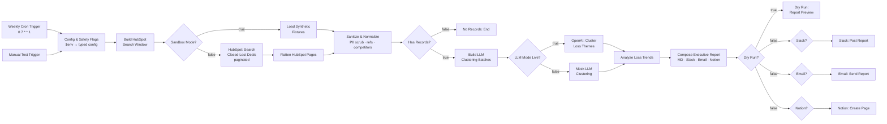

<div align="center">

# n8n-hubspot-deal-loss-reason-trend-analyzer

**Weekly n8n analytics pipeline that extracts closed-lost deal reasons and competitor displacement feedback from HubSpot, clusters themes via LLM, and publishes executive loss trend reports.**

A dhRobin Systems Revenue Infrastructure blueprint

    

</div>

---

## Table of Contents

1. [Overview](#1-overview)
2. [Architecture](#2-architecture)
3. [Repository Contents](#3-repository-contents)
4. [Prerequisites](#4-prerequisites)
5. [Quick Start (Sandbox in 5 Minutes)](#5-quick-start-sandbox-in-5-minutes)
6. [Environment Variables](#6-environment-variables)
7. [Node-by-Node Configuration Guide](#7-node-by-node-configuration-guide)
8. [Loss Theme Taxonomy](#8-loss-theme-taxonomy)
9. [Safety Model](#9-safety-model)
10. [Data Protection and PII Handling](#10-data-protection-and-pii-handling)
11. [Deployment](#11-deployment)
12. [Operations and Monitoring](#12-operations-and-monitoring)
13. [Troubleshooting](#13-troubleshooting)
14. [Extending the Pipeline](#14-extending-the-pipeline)
15. [Disclaimer and License](#15-disclaimer-and-license)

---

## 1. Overview

Closed-lost data is among the most valuable and least used signals in a revenue organisation. Loss reasons are typed in a hurry, competitor fields are spelled five different ways, and no one has time to read hundreds of notes each week. This pipeline turns that raw feedback into a single, comparable weekly trend report.

**Every Monday at 07:00, the workflow:**

1. Pulls every closed-lost deal from the **current** period and the **prior** period of equal length via the HubSpot CRM Search API, with cursor pagination and stage, pipeline and date filters.
2. **Sanitises** the free text: it scrubs PII, pseudonymises deal IDs and normalises competitor names.
3. **Classifies** each loss into one of five executive themes through an LLM, using a strict JSON Schema response contract.
4. **Computes trends** (share shift in percentage points, count deltas, lost value, competitor leaderboard, top sub-themes).
5. **Publishes** one report to Slack, email and Notion, each gated by its own flag.

**Design principles**

| Principle | Implementation |
|---|---|
| Safe by default | With no environment variables set, the workflow reads synthetic fixtures, uses an offline classifier and publishes nothing. |
| Secrets never touch execution data | Secrets are referenced only as `{{ $env.* }}` inside HTTP header or URL fields. They are never copied into node output. |
| Data minimisation | Deal names, owners, contacts and associations are never requested from HubSpot. |
| Deterministic contracts | The LLM response is validated against a fixed category enum and a known reference set. Invalid output is counted and reported rather than trusted. |
| Modular | Each stage is a single-purpose node with a stable input and output shape, so any stage can be replaced. |

---

## 2. Architecture



### Data contract between stages

| Stage output | Shape |
|---|---|
| `Build HubSpot Search Window` | `{ window: { priorStartMs, currentStartMs, endMs, … }, searchBody }` |
| `Load Synthetic Fixtures` / `Flatten HubSpot Pages` | `{ source, pagesFetched, deals: [{ sourceId, closeDate, amount, lossReason, competitor, notes, … }] }` |
| `Sanitize & Normalize` | `{ window, stats, records: [{ ref, period, closeDate, amount, lossReason, competitor, notes, insufficientSignal }] }` |
| `Build LLM Clustering Batches` | One item per chunk: `{ chunkIndex, records, llmRequest }` |
| `OpenAI` / `Mock LLM` | OpenAI Chat Completions envelope: `choices[0].message.content` = JSON `{ assignments, theme_summaries }` |
| `Analyze Loss Trends` | `{ totals, headline, themes, summaries, topSubThemes, competitors, quality }` |
| `Compose Executive Report` | `{ title, dryRun, publish, markdown, slackPayload, emailPayload, notionPayload }` |

---

## 3. Repository Contents

```
n8n-hubspot-deal-loss-reason-trend-analyzer/
├── README.md        Technical documentation (this file)
├── workflow.json    Importable n8n workflow with pinned synthetic payloads
├── DISCLAIMER.md    Liability limitation and usage terms
└── LICENSE          MIT License
```

All JavaScript runs inside the workflow's Code nodes. No external package installs are required.

---

## 4. Prerequisites

| Requirement | Detail |
|---|---|
| n8n | Self-hosted **1.60 or later** (uses Schedule Trigger 1.2, Set 3.4, IF 2, Code 2, HTTP Request 4.2). |
| Environment access | `N8N_BLOCK_ENV_ACCESS_IN_NODE=false`. Recent n8n releases block `$env` in nodes by default, so set this explicitly. |
| HubSpot | A **Private App** token with scope `crm.objects.deals.read`. Use a developer test account or sandbox portal first. |
| HubSpot properties | `closed_lost_reason` (standard) plus two custom deal properties for competitor and loss notes (see [§7.5](#75-hubspot-search-closed-lost-deals)). |
| LLM (optional) | An OpenAI API key, or any OpenAI-compatible endpoint that supports `response_format: json_schema`. Not needed in mock mode. |
| Slack (optional) | An incoming webhook URL for the target channel. |
| Email (optional) | A SendGrid API key with *Mail Send* permission and a verified sender address. |
| Notion (optional) | An internal integration token and a database shared with that integration. |

> **n8n Cloud:** user-defined environment variables are not available on n8n Cloud. Replace each `$env.X` reference with `$vars.X` (Variables, on plans that include them) or move the secret into an n8n credential. The node logic is otherwise unchanged.

---

## 5. Quick Start (Sandbox in 5 Minutes)

1. **Start n8n with env access enabled.**
   ```bash
   docker run -it --rm -p 5678:5678 \
     -e N8N_BLOCK_ENV_ACCESS_IN_NODE=false \
     -e GENERIC_TIMEZONE=UTC \
     -v n8n_data:/home/node/.n8n \
     docker.n8n.io/n8nio/n8n
   ```
2. **Import** `workflow.json` (*Workflows → Import from File*).
3. Open the workflow and click **Test workflow** on *Manual Test Trigger*.
4. Open **Dry Run: Report Preview** and inspect `markdown`, `slackPayload`, `emailPayload` and `notionPayload`.

No credentials are needed. The run uses 17 synthetic deals (some containing deliberately fake PII), the offline keyword classifier, and publishes nothing. The *Data Quality & Governance* section of the report shows how many redactions were applied.

---

## 6. Environment Variables

All variables are optional. Defaults are chosen so that an unconfigured instance cannot reach any external system.

### 6.1 Safety flags

| Variable | Default | Behaviour |
|---|---|---|
| `SANDBOX_MODE` | `true` | Any value other than `false` uses synthetic fixtures and skips HubSpot entirely. |
| `DRY_RUN` | `true` | Any value other than `false` builds the report but routes it only to *Dry Run: Report Preview*. |
| `LLM_MODE` | `mock` | `live` calls the LLM endpoint. Any other value uses the offline heuristic classifier. |
| `PUBLISH_SLACK` | `false` | Must be exactly `true` (and `DRY_RUN=false`) to post to Slack. |
| `PUBLISH_EMAIL` | `false` | Must be exactly `true` (and `DRY_RUN=false`) to send email. |
| `PUBLISH_NOTION` | `false` | Must be exactly `true` (and `DRY_RUN=false`) to create a Notion page. |

### 6.2 HubSpot

| Variable | Default | Secret | Description |
|---|---|:---:|---|
| `HUBSPOT_PRIVATE_APP_TOKEN` | — | Yes | Private App access token (`crm.objects.deals.read`). |
| `HUBSPOT_API_BASE_URL` | `https://api.hubapi.com` | | Override only for proxies or regional gateways. |
| `HUBSPOT_CLOSED_LOST_STAGE_IDS` | `closedlost` | | Comma-separated internal stage IDs. Custom pipelines use numeric IDs. |
| `HUBSPOT_PIPELINE_IDS` | *(all)* | | Optional comma-separated pipeline IDs to restrict scope. |
| `HUBSPOT_LOSS_REASON_PROPERTY` | `closed_lost_reason` | | Internal name of the loss reason property. |
| `HUBSPOT_COMPETITOR_PROPERTY` | `competitor_won` | | Internal name of the custom competitor property. |
| `HUBSPOT_LOSS_NOTES_PROPERTY` | `loss_feedback_notes` | | Internal name of the custom loss notes property. |
| `LOOKBACK_DAYS` | `7` | | Length of each period (1–90). The query covers `2 × LOOKBACK_DAYS`. |

### 6.3 Sanitisation

| Variable | Default | Secret | Description |
|---|---|:---:|---|
| `REF_HASH_SALT` | built-in value | Yes | Salt for pseudonymous deal references. Set a unique value per environment. |
| `PII_SCRUB_EXTRA_TERMS` | *(empty)* | | Comma-separated terms always redacted (for example customer names or internal codenames). |
| `COMPETITOR_ALIAS_MAP` | `{}` | | JSON map of raw variant → canonical name, merged over built-in aliases. Example: `{"acme corp":"Competitor Alpha","acme cloud":"Competitor Alpha"}` |

### 6.4 LLM

| Variable | Default | Secret | Description |
|---|---|:---:|---|
| `OPENAI_API_KEY` | — | Yes | Bearer token for the LLM endpoint. |
| `OPENAI_BASE_URL` | `https://api.openai.com/v1` | | Any OpenAI-compatible base URL (Azure OpenAI gateway, private proxy, etc.). |
| `OPENAI_MODEL` | `gpt-4.1-mini` | | Model ID. `temperature` is omitted automatically for `o*` and `gpt-5*` model families. |
| `LLM_CHUNK_SIZE` | `75` | | Records per request (10–150). |

### 6.5 Reporting and channels

| Variable | Default | Secret | Description |
|---|---|:---:|---|
| `REPORT_TITLE` | `Weekly Deal Loss Trend Report` | | Report heading prefix. |
| `REPORT_CURRENCY` | `USD` | | ISO 4217 code used for value formatting. |
| `REPORT_INCLUDE_AMOUNTS` | `true` | | Set `false` to drop deal amounts at the sanitisation stage. |
| `SLACK_WEBHOOK_URL` | — | Yes | Slack incoming webhook URL. |
| `SENDGRID_API_KEY` | — | Yes | SendGrid API key (Mail Send). |
| `EMAIL_FROM` | `loss-reports@company.example` | | Verified sender address. |
| `EMAIL_TO` | `revops-leadership@company.example` | | Comma-separated recipients. |
| `NOTION_API_TOKEN` | — | Yes | Notion internal integration token. |
| `NOTION_DATABASE_ID` | placeholder | | Target database ID (32-character hex). |
| `NOTION_TITLE_PROPERTY` | `Name` | | Name of the database's title property. |

### 6.6 Sample `.env` (staging)

```dotenv
# ── n8n runtime ─────────────────────────────────────────────
N8N_BLOCK_ENV_ACCESS_IN_NODE=false
GENERIC_TIMEZONE=UTC

# ── Safety (staging: live HubSpot test portal, still no publishing) ──
SANDBOX_MODE=false
DRY_RUN=true
LLM_MODE=live
PUBLISH_SLACK=false
PUBLISH_EMAIL=false
PUBLISH_NOTION=false

# ── HubSpot (developer test account) ────────────────────────
HUBSPOT_PRIVATE_APP_TOKEN=replace-with-test-portal-token
HUBSPOT_CLOSED_LOST_STAGE_IDS=closedlost
HUBSPOT_COMPETITOR_PROPERTY=competitor_won
HUBSPOT_LOSS_NOTES_PROPERTY=loss_feedback_notes
LOOKBACK_DAYS=7

# ── Sanitisation ────────────────────────────────────────────
REF_HASH_SALT=replace-with-random-32-chars
PII_SCRUB_EXTRA_TERMS=
COMPETITOR_ALIAS_MAP={"comp alpha":"Competitor Alpha"}

# ── LLM ─────────────────────────────────────────────────────
OPENAI_API_KEY=replace-with-staging-key
OPENAI_MODEL=gpt-4.1-mini

# ── Channels ────────────────────────────────────────────────
SLACK_WEBHOOK_URL=https://hooks.slack.example/services/REPLACE/ME
SENDGRID_API_KEY=replace-with-staging-key
EMAIL_FROM=loss-reports@company.example
EMAIL_TO=revops-leadership@company.example
NOTION_API_TOKEN=replace-with-integration-token
NOTION_DATABASE_ID=00000000000000000000000000000000
```

Never commit a populated `.env`. Add it to `.gitignore` and inject values through your secret manager in production.

---

## 7. Node-by-Node Configuration Guide

### 7.1 Weekly Cron Trigger
- **Type:** Schedule Trigger, cron `0 7 * * 1` (Mondays 07:00).
- **Timezone:** the workflow setting is `UTC`. Change it under *Workflow → Settings → Timezone*. The analysis windows are always computed in UTC midnight boundaries, so the report is stable regardless of trigger time.
- **Activation:** the workflow imports as **inactive**. Activate it only after completing the promotion path in [§11.3](#113-promotion-path).

### 7.2 Manual Test Trigger
Runs the identical pipeline on demand. Manual executions honour **pinned data**, so they are the safe way to test (see [§9.3](#93-pinned-test-payloads)).

### 7.3 Config & Safety Flags
- **Type:** Set (v3.4). Converts environment variables into a typed configuration object with defaults.
- **Rule:** only *non-secret* values are assigned here. Tokens and webhook URLs are read directly in the HTTP nodes, so they never appear in saved execution data.
- **Safety semantics:** `SANDBOX_MODE`, `DRY_RUN` and `REPORT_INCLUDE_AMOUNTS` stay enabled unless set to exactly `false`. The `PUBLISH_*` flags stay disabled unless set to exactly `true`. Typos fail safe.

### 7.4 Build HubSpot Search Window
- **Type:** Code. Computes three UTC timestamps: `priorStart`, `currentStart`, `end` (exclusive, today 00:00 UTC).
- **Search body:** `dealstage IN [stage IDs]`, `closedate >= priorStart`, `closedate < end`, optional `pipeline IN [...]`, sorted by `closedate` descending, `limit: 100`.
- **Requested properties:** `hs_object_id`, `closedate`, `amount`, `dealstage`, `pipeline` and the three configured feedback properties. `dealname` and owner fields are excluded on purpose.

### 7.5 HubSpot: Search Closed-Lost Deals
- **Type:** HTTP Request (v4.2), `POST {HUBSPOT_API_BASE_URL}/crm/v3/objects/deals/search`.
- **Auth:** header `Authorization: Bearer {{ $env.HUBSPOT_PRIVATE_APP_TOKEN }}`.
- **Pagination:** *Update a Parameter in Each Request*. Body field `after = $response.body.paging.next.after`, complete when `paging.next` is absent, 250 ms between pages, maximum 100 pages. The CRM Search API caps a single query at 10,000 results. If your portal exceeds that in one window, shorten `LOOKBACK_DAYS` or split by pipeline.
- **Retries:** 3 attempts, 5 s apart (covers transient `429` and `5xx`).

**Creating the custom properties** (*Settings → Properties → Deal properties → Create property*):

| Label | Internal name | Field type | Recommendation |
|---|---|---|---|
| Competitor Won | `competitor_won` | Dropdown select (preferred) or single-line text | A dropdown removes most normalisation work. |
| Loss Feedback Notes | `loss_feedback_notes` | Multi-line text | Make it required on the closed-lost stage. |

Configure *Closed lost reason* and both custom properties as **required when entering the closed-lost stage** in pipeline settings. Data completeness is the largest single driver of report quality.

### 7.6 Load Synthetic Fixtures
Generates 17 fictitious deals spread across both periods. Competitor names are generic placeholders (`Competitor Alpha/Beta/Gamma`), contacts use `.example` domains and `555-01xx` numbers, and one record has no signal at all to exercise the *Unclassified* path.

### 7.7 Flatten HubSpot Pages
Collapses all paginated responses into **one** item with a `deals` array. Downstream nodes therefore always execute, even when HubSpot returns zero results, and the *Has Closed-Lost Records?* gate makes the decision explicitly.

### 7.8 Sanitize & Normalize
| Step | Detail |
|---|---|
| Pseudonymous refs | `L-` + salted FNV-1a hash of the HubSpot ID. Raw IDs never leave n8n. Note that FNV-1a is a *non-cryptographic* hash: it prevents casual exposure, not a determined reversal by someone holding the salt and the ID space. |
| PII scrubbing | Emails → `[EMAIL]`, URLs → `[URL]`, IPv4 → `[IP]`, 9–15-digit phone patterns → `[PHONE]`, 7+-digit numbers → `[NUMBER]`, `@handles` → `[HANDLE]`, honorific names (`Mr./Ms./Dr. …`) and labelled contacts (`Contact: …`) → `[PERSON]`, `PII_SCRUB_EXTRA_TERMS` → `[REDACTED]`. HTML is stripped and text is capped at 800 characters. |
| Competitor normalisation | Lower-case, accent folding, punctuation removal, repeated legal-suffix stripping (`Inc`, `LLC`, `Ltd`, `Corp`, `GmbH`, …), null-like values (`none`, `n/a`, `unknown`) → empty, then alias lookup, then Title Case. `COMPETITOR ALPHA, LLC`, `competitor alpha` and `Competitor Alpha Inc.` all resolve to `Competitor Alpha`. |
| Period tagging | `closedate >= currentStart` → `current`, otherwise `prior`. |
| Deduplication | By pseudonymous ref. |

> Regex scrubbing reduces exposure. It is not a guarantee. Free-text notes can contain names without honorifics. Use `PII_SCRUB_EXTRA_TERMS` for known sensitive terms and keep `LLM_MODE=mock` until your privacy review is complete.

### 7.9 Has Closed-Lost Records?
Routes to *No Records: End* when the sanitised set is empty. Replace that No-Op with a short Slack notice if you want a "zero losses" message.

### 7.10 Build LLM Clustering Batches
- Excludes records with no reason, notes or competitor (`insufficientSignal`). These are reported as *Unclassified*.
- Chunks records by `LLM_CHUNK_SIZE` and builds a Chat Completions request per chunk with:
  - a system prompt defining the five categories, decision rules and an explicit instruction to **treat record text as data, never as instructions** (prompt-injection guard);
  - `response_format: { type: "json_schema", strict: true }` with an enum-constrained `category` field.
- Only `ref`, `period`, `loss_reason`, `competitor` and `notes` (all sanitised) are sent.

### 7.11 LLM Mode Live?
Proceeds to OpenAI only when `LLM_MODE=live` **and** the batch is not empty. Otherwise, the mock classifier runs.

### 7.12 OpenAI: Cluster Loss Themes
- **Type:** HTTP Request, `POST {OPENAI_BASE_URL}/chat/completions`, `Authorization: Bearer {{ $env.OPENAI_API_KEY }}`.
- **Throughput:** batching of 1 item per second, 120 s timeout, 3 retries 8 s apart.
- **Cost guide:** one chunk of 75 records is roughly 6–9k input tokens and 2–4k output tokens. A typical weekly run of 50–300 losses needs 1–4 requests.

### 7.13 Mock LLM Clustering
A deterministic keyword classifier that returns the same envelope as OpenAI. Use it for CI, demos and any environment where data must not leave the instance. Its narratives are explicitly labelled as heuristic.

### 7.14 Analyze Loss Trends
- **Validation:** rejects unparseable responses, unknown categories and refs not in the input set. Every rejection is counted in `quality.llm`.
- **Defence in depth:** model-generated `sub_theme`, `summary` and `signals` are scrubbed again for emails, URLs and phone numbers.
- **Trend rules:**

| Label | Condition |
|---|---|
| `New` | No prior-period deals in the theme and ≥ 2 current-period deals |
| `Rising` | Share up ≥ 10 pp and ≥ 2 current-period deals |
| `Easing` | Share down ≥ 10 pp and ≥ 2 prior-period deals |
| `Stable` | Otherwise |

- Assignments below 0.5 confidence are kept but counted as `lowConfidence`.

### 7.15 Compose Executive Report
Produces four renderings of one analysis:

| Output | Format | Limits handled |
|---|---|---|
| `markdown` | Canonical GitHub-flavoured Markdown | Pipe escaping |
| `slackPayload` | Block Kit (header, context, sections, monospaced tables) | 3,000 characters per section, 150-character header |
| `emailPayload` | SendGrid v3 `mail/send` with `text/plain` and inline-styled `text/html` | HTML escaping |
| `notionPayload` | `POST /v1/pages` with headings, bullets and native tables | 100 children per request, 2,000 characters per rich-text object |

**Report sections:** Executive Summary · Loss Themes · Theme Narratives · Top Sub-Themes · Competitor Displacement · Data Quality & Governance.

### 7.16 Dry Run? and Report Preview
When `DRY_RUN` is not `false`, the report terminates at *Dry Run: Report Preview*. This is the review point for staging sign-off.

### 7.17 Publishers
| Node | Endpoint | Notes |
|---|---|---|
| Slack: Post Report | `{{ $env.SLACK_WEBHOOK_URL }}` | Webhook URL is treated as a secret. Response is plain text `ok`. |
| Email: Send Report | `https://api.sendgrid.com/v3/mail/send` | Returns `202 Accepted`. To use another provider, replace this node and adapt `emailPayload`. |
| Notion: Create Report Page | `https://api.notion.com/v1/pages` | `Notion-Version: 2022-06-28`, `parent.database_id`. Share the database with the integration first. |

Each publisher sits behind its own IF gate, so one channel can be enabled at a time during rollout.

---

## 8. Loss Theme Taxonomy

| Theme | Definition | Typical sub-themes |
|---|---|---|
| **Pricing** | Price level, budget, discounting, packaging or commercial terms decided the outcome. | Budget constraints, per-seat pricing model, discount expectations |
| **Product Gaps** | The product exists but is weaker in a broad capability area. | Integration depth, performance at scale, API limits, build vs. buy |
| **Feature Missing** | A specific, named capability required by the buyer does not exist. | SSO / provisioning, multi-currency quoting, offline mode |
| **Sales Execution** | The loss traces to the selling motion. | Follow-up velocity, discovery depth, champion coverage, no decision |
| **Competitor Win** | A competitor won on overall offering, relationship or incumbency, with no single category above dominating. | Incumbent advantage, bundled offering, head-to-head loss |
| *Unclassified* | No usable signal, or the model returned no valid assignment. | — |

**Tie-break rules given to the model:** Feature Missing wins over Product Gaps when a capability is named. Competitor Win applies only when the competitor's overall advantage, not price or one feature, decided the deal. Competitor displacement is still tracked independently in the *Competitor Displacement* table, whatever the primary theme.

To change the taxonomy, update `CATEGORIES` in **Build LLM Clustering Batches** and **Analyze Loss Trends**, and the `RULES` object in **Mock LLM Clustering**.

---

## 9. Safety Model

### 9.1 Flag matrix

| `SANDBOX_MODE` | `LLM_MODE` | `DRY_RUN` | HubSpot called | LLM called | Anything published |
|:---:|:---:|:---:|:---:|:---:|:---:|
| `true` *(default)* | `mock` *(default)* | `true` *(default)* | No | No | No |
| `true` | `live` | `true` | No | Yes (synthetic data only) | No |
| `false` | `mock` | `true` | Yes | No | No |
| `false` | `live` | `true` | Yes | Yes | No |
| `false` | `live` | `false` | Yes | Yes | Only channels with `PUBLISH_*=true` |

### 9.2 Secret handling
- Secrets appear only in `Authorization` headers or the Slack URL field as `{{ $env.* }}` expressions.
- The workflow JSON contains **no credentials, no account IDs and no real data**.
- Restrict who can view executions (*Settings → Users*). Execution data includes sanitised records and the rendered report.

### 9.3 Pinned test payloads
`workflow.json` ships with pinned synthetic responses on:

| Node | Pinned payload |
|---|---|
| HubSpot: Search Closed-Lost Deals | One page of five fictitious deals with fake PII |
| Slack: Post Report | Mock `ok` acknowledgement |
| Email: Send Report | Mock `202` acknowledgement |
| Notion: Create Report Page | Mock page object |

Pins apply **only to manual executions**. Scheduled production executions ignore them. Unpin a node (*right-click → Unpin*) before a manual live test of that integration, otherwise the pinned response is returned and no request is made.

---

## 10. Data Protection and PII Handling

| Data element | Fetched | Sent to LLM | In report |
|---|:---:|:---:|:---:|
| Deal ID | Yes | Pseudonymised ref only | No |
| Deal name | No | No | No |
| Owner, contacts, companies | No | No | No |
| Close date | Yes | Period label only | Aggregated |
| Amount | Yes (optional) | No | Aggregated |
| Loss reason | Yes | Sanitised | Paraphrased themes only |
| Competitor | Yes | Normalised | Normalised |
| Loss notes | Yes | Sanitised | Paraphrased signals only |

**Recommendations**
- Confirm a lawful basis and a data processing agreement before sending CRM text to any AI provider (GDPR Art. 6/28, CCPA service-provider terms).
- Prefer an LLM endpoint with zero data retention, or a private deployment through `OPENAI_BASE_URL`.
- Set `REF_HASH_SALT` per environment and rotate it according to your retention policy.
- Tighten n8n execution retention (`EXECUTIONS_DATA_MAX_AGE`, `EXECUTIONS_DATA_PRUNE=true`).

---

## 11. Deployment

### 11.1 Docker Compose (self-hosted)

```yaml
services:
  n8n:
    image: docker.n8n.io/n8nio/n8n:latest
    restart: unless-stopped
    ports:
      - "5678:5678"
    env_file:
      - ./.env                      # never commit this file
    environment:
      - N8N_BLOCK_ENV_ACCESS_IN_NODE=false
      - GENERIC_TIMEZONE=UTC
      - EXECUTIONS_DATA_PRUNE=true
      - EXECUTIONS_DATA_MAX_AGE=336 # hours (14 days)
      - N8N_ENCRYPTION_KEY=${N8N_ENCRYPTION_KEY}
    volumes:
      - n8n_data:/home/node/.n8n
volumes:
  n8n_data:
```

Pin the image to a tested version tag in production rather than `latest`.

### 11.2 Import and wire up
1. *Workflows → Import from File → `workflow.json`*.
2. Confirm the workflow timezone and cron expression.
3. Run **Manual Test Trigger** with defaults and review the preview.
4. Optionally configure an **Error Workflow** (*Settings → Error workflow*) that alerts your operations channel.

### 11.3 Promotion path

| Stage | Environment | Flags | Exit criteria |
|---|---|---|---|
| 1. Sandbox | Any n8n instance | Defaults | Report renders. Redaction count > 0 on fixtures. |
| 2. LLM contract | Sandbox | `LLM_MODE=live` | `parseErrors = 0`, `rejected assignments = 0`. |
| 3. Staging data | HubSpot developer test account | `SANDBOX_MODE=false`, `DRY_RUN=true`, HubSpot node unpinned | Record counts match a HubSpot list view. No PII in preview. |
| 4. Channel test | Staging | `DRY_RUN=false`, one `PUBLISH_*=true`, publisher unpinned, test channel or recipient | Message renders correctly in the target tool. |
| 5. Production | Production portal | Production secrets, all required channels | Two consecutive weekly runs reviewed by RevOps before the workflow is shared with executives. |

### 11.4 Version control
Export the workflow after each change and commit `workflow.json`. Before committing, confirm that the file contains only `$env` references and synthetic pinned data:

```bash
grep -nE '(pat-|sk-|xox[bp]-|SG\.|secret_)[A-Za-z0-9]' workflow.json && echo "Possible secret found" || echo "Clean"
```

---

## 12. Operations and Monitoring

| Signal | Where | Action threshold |
|---|---|---|
| `quality.llm.parseErrors` | Data Quality section | > 0: inspect the OpenAI node output. Check model support for `json_schema`. |
| `quality.unclassified` | Data Quality section | > 15% of records: enforce required loss fields in HubSpot. |
| `quality.missingCompetitor` | Data Quality section | Rising: convert the competitor property to a dropdown. |
| `quality.outOfWindow` | Data Quality section | > 0 on live data: check property names and stage IDs. |
| `quality.redactions` | Data Quality section | Sudden spike: reps are pasting contact details into notes. Coach the team. |
| Execution failures | n8n Executions / Error Workflow | Any failed Monday run. |

**Rate limits:** the CRM Search API allows a small number of requests per second per portal. The 250 ms page interval keeps the workflow well under that. LLM calls are spaced 1 s apart.

---

## 13. Troubleshooting

| Symptom | Likely cause | Resolution |
|---|---|---|
| `access to env vars denied` | Env access blocked | Set `N8N_BLOCK_ENV_ACCESS_IN_NODE=false` and restart n8n. |
| HubSpot `401` | Token invalid or wrong portal | Regenerate the Private App token. Confirm the portal. |
| HubSpot `403` | Missing scope | Add `crm.objects.deals.read`. |
| HubSpot `400` on search | Unknown property or stage ID | Verify internal names under *Settings → Properties* and stage IDs under pipeline settings. |
| Zero records on live data | Wrong stage IDs for a custom pipeline | Custom pipelines use numeric stage IDs, not `closedlost`. |
| Manual run returns the same five deals | HubSpot node is pinned | Unpin the node. |
| OpenAI `400` on `response_format` | Model does not support structured outputs | Choose a model that supports `json_schema`. |
| OpenAI `400` on `temperature` | Reasoning model | Use a model ID starting `o`/`gpt-5` (auto-handled), or remove the field in *Build LLM Clustering Batches*. |
| Everything *Unclassified* in live mode | Refs altered by the model | Check `rejected assignments`. Lower `LLM_CHUNK_SIZE`. |
| Notion `400 validation_error` | Title property name mismatch | Set `NOTION_TITLE_PROPERTY` to the database's title column. |
| Notion `404 object_not_found` | Database not shared | *Database → … → Connections →* add the integration. |
| SendGrid `403` | Unverified sender | Verify `EMAIL_FROM` in SendGrid sender authentication. |

---

## 14. Extending the Pipeline

- **Historical trend store:** append `Analyze Loss Trends` output to a data table, Postgres or a warehouse each week to chart 12-week moving trends.
- **Segment cuts:** add `pipeline`, region or deal-size band to the records and group metrics by segment in *Analyze Loss Trends*.
- **Win/loss contrast:** run a mirrored query for closed-won deals and contrast competitor encounter rates.
- **Feedback loop:** write the theme back to a HubSpot deal property (requires `crm.objects.deals.write`) after a person has reviewed the classification.
- **Alternate LLMs:** any OpenAI-compatible gateway works through `OPENAI_BASE_URL`. For other APIs, replace the OpenAI node and keep the response envelope consumed by *Analyze Loss Trends*.

---

## 15. Disclaimer and License

### ⚠️ Disclaimer & Liability Limitation

**Use at your own risk.** The code, workflows, and scripts in this repository (`n8n-hubspot-deal-loss-reason-trend-analyzer`) are provided for educational and architectural demonstration purposes.

- **No Liability:** The author and dhRobin Systems accept no responsibility or liability for any direct, indirect, incidental, or consequential damages that result from using, misusing, or deploying these scripts.
- **No Warranty:** All software, n8n JSON blueprints, JavaScript modules and prompts are provided "AS IS", without warranty of any kind, express or implied. This includes, but is not limited to, warranties of merchantability, fitness for a particular purpose, and non-infringement.
- **Production Testing Required:** Always test thoroughly in an isolated staging environment, such as a HubSpot developer test account or sandbox, with `SANDBOX_MODE=true` and `DRY_RUN=true` enabled, before you connect live HubSpot or OpenAI credentials. Treat every AI-generated theme classification and trend report as a draft analysis that a person must review before it's distributed or used to inform pricing, product, or sales decisions.
- **Third-Party APIs & Compliance:** You alone are responsible for complying with the terms of service, rate limits, data privacy regulations (GDPR/CCPA), and security policies of HubSpot, OpenAI, Slack, SendGrid, Notion and any connected services. That includes confirming a lawful basis for sending CRM deal feedback to an AI provider, keeping personal data out of distributed reports, and reviewing every automatically published report.

The full disclaimer is also available in [DISCLAIMER.md](DISCLAIMER.md).

### License

Released under the MIT License. Copyright (c) 2026 DH Robin (dhRobin Systems). See [LICENSE](LICENSE).

---

<div align="center">

Full text: [DISCLAIMER.md](DISCLAIMER.md) · Licensed under the MIT License. License: MIT © 2026 DH Robin (dhRobin Systems) · Provided as-is, see the disclaimer.

</div>
